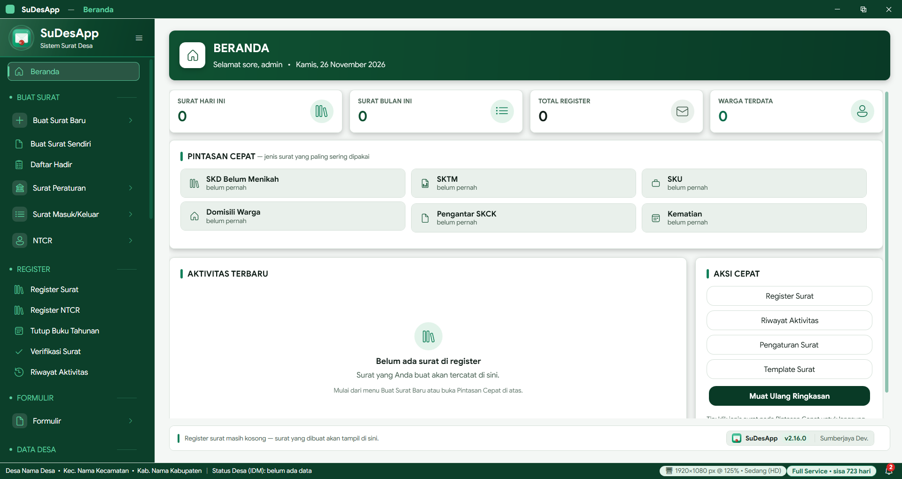

<p align="center">
  <!-- Tangkapan layar Beranda, bukan ikon aplikasi (dan bukan Resources/logo.png:
       berkas itu lambang Kabupaten Karawang untuk kop surat, bukan merek SuDesApp).
       Sumber: build Debug dengan `desa.db` kosong sehingga tidak ada data warga nyata.
       Gambar README sengaja di `.github/assets`, bukan `docs/`: seluruh isi `docs/`
       ikut disalin csproj ke folder aplikasi dan ke paket installer. -->
  
</p>

<p align="center">
  <sub>Beranda SuDesApp — menu utama di sidebar, ringkasan surat di kartu statistik, dan pintasan jenis surat yang paling sering dipakai.</sub>
</p>

<h1 align="center">SuDesApp — Sistem Surat Desa</h1>

<p align="center">
  Aplikasi administrasi dan surat-menyurat desa yang bekerja <strong>offline-first</strong>:
  desktop Windows, pendamping Android, backend API, dan server lisensi.
</p>

<p align="center">
  <a href="https://github.com/inomixstudio/SuDesApp/releases/latest"></a>
  <a href="LICENSE"></a>
  
  
  <a href="SECURITY.md"></a>
</p>

SuDesApp membantu pemerintah desa menyusun surat resmi secara cepat, akurat, dan
konsisten. Pembuatan surat, register, agenda, data penduduk, APBDes, IDM, sampai
alur persetujuan berjalan di komputer desa tanpa internet. Data warga tetap
tersimpan lokal di `desa.db`; server lisensi hanya menerima keterangan langganan.

Masa uji coba **30 hari** aktif otomatis. Setelah berakhir, data tetap dapat
dibaca dan dicadangkan, tetapi cetak PDF/ekspor Excel (kecuali Daftar Hadir) dan
sinkron Android dikunci sampai lisensi diaktifkan.

## Daftar isi

- [Fitur utama](#fitur-utama)
- [Unduh dan pasang](#unduh-dan-pasang)
- [Menjalankan dari sumber](#menjalankan-dari-sumber)
- [Arsitektur](#arsitektur)
- [Struktur repositori](#struktur-repositori)
- [Uji dan kualitas](#uji-dan-kualitas)
- [Keamanan dan privasi](#keamanan-dan-privasi)
- [Lisensi](#lisensi)
- [Kontribusi](#kontribusi)
- [Dokumentasi](#dokumentasi)
- [Dukungan](#dukungan)

## Fitur utama

### Surat dan cetak

- **27 jenis surat bawaan** — SKTM, SKU, domisili, kematian, NTCR N1–N6 dan N8,
  rekening koran, keterangan penghasilan, dan lain-lain; penomoran otomatis
  mengikuti Perbup (rujukan di
  [`docs/referensi-penomoran-surat.md`](docs/referensi-penomoran-surat.md)).
- **Template Surat sendiri** — susun jenis surat baru lewat wizard atau impor
  berkas Word, lengkap dengan kolom isian, tanda tangan, dan penomoran.
- **Pratinjau sebelum mengisi** — SudesPdf menampilkan kerangka surat dengan
  kolom kosong sebagai titik-titik, tanpa menyimpan apa pun ke register.
- **Logo kabupaten otomatis** — 514 lambang kabupaten/kota se-Indonesia tersedia;
  begitu kabupaten dipilih di Pengaturan Surat, lambang kop terpasang otomatis
  dan tetap konsisten setelah restart (lihat
  [`Resources/LogosKabupaten/README.md`](Resources/LogosKabupaten/README.md)).
- **Alur persetujuan opsional** — per surat: ajukan → verifikasi → tanda tangan
  (atau tolak), dengan label status dan lampiran scan bertanda tangan
  ([`docs/alur-persetujuan-surat.md`](docs/alur-persetujuan-surat.md)).
- **QR verifikasi** — setiap surat terbit membawa kode dan QR di kaki surat
  sehingga bank atau instansi dapat memeriksa keasliannya.

### Data dan arsip

- **Register dan agenda** — register surat, register NTCR, buku agenda surat
  masuk/keluar, arsip keputusan/Perdes, dengan ekspor Excel/CSV/JSON/PDF.
- **Data warga** — penduduk, Kartu Keluarga, mutasi (aktif/baru/pindah/meninggal),
  impor dan ekspor massal, serta laporan rekapitulasi kependudukan.
- **Perangkat desa dan SK** — data perangkat per kelompok jabatan, SK dengan
  lampiran tabel nama, dan ekspor/cetak
  ([`docs/perangkat-desa-dan-sk.md`](docs/perangkat-desa-dan-sk.md)).
- **APBDes dan IDM** — arsip dokumen anggaran per tahun/tahapan dan halaman
  Indeks Desa dengan skor, status, tren, serta cetak PDF
  ([`docs/apbdes-arsip-dokumen.md`](docs/apbdes-arsip-dokumen.md)).
- **Tutup buku tahunan** — periksa keutuhan penomoran, tutup/buka buku, dan
  cetak arsip register
  ([`docs/policy-tutup-buku-dan-retensi.md`](docs/policy-tutup-buku-dan-retensi.md)).

### Layanan digital

- **API desa** — endpoint HTTP lokal untuk statistik, data perangkat desa,
  status persetujuan, rekap laporan, dan verifikasi keaslian surat
  ([`docs/api-desa.md`](docs/api-desa.md)).
- **Backend web** — `SuDesApp.Api` (ASP.NET Core) membuka data desa untuk klien
  mobile/browser: masuk memakai akun desktop, data warga, register surat,
  statistik, dan kelola pengguna ([`docs/backend-web.md`](docs/backend-web.md)).
- **Sinkron Android** — aplikasi Android native (Kotlin) menarik kop dan pola
  nomor dari desktop via Supabase, membuat surat dan PDF di perangkat, lalu
  mengantrekan isian untuk diimpor desktop. Desktop tetap otoritas nomor resmi;
  perangkat dipasangkan lewat QR atau kode 4 angka
  ([`docs/sinkronisasi-android.md`](docs/sinkronisasi-android.md)).
- **Pembaruan otomatis** — rilis diperiksa dan diunduh di latar belakang,
  diverifikasi SHA-256, lalu dipasang sebagai tambalan kecil atau installer
  penuh ([`docs/PEMBARUAN-TAMBALAN.md`](docs/PEMBARUAN-TAMBALAN.md)).

### Keamanan dan lisensi

- **Lisensi bertanda tangan** — status langganan diverifikasi lokal memakai
  token ECDSA P-256, dengan masa tenggang 7 hari saat internet putus
  ([`docs/langganan-dan-lisensi.md`](docs/langganan-dan-lisensi.md)).
- **Multi-pengguna** — akun dengan peran dan izin, kunci akun setelah percobaan
  login gagal, serta halaman Pengguna & Peran
  ([`docs/policy-peran-pengguna.md`](docs/policy-peran-pengguna.md)).
- **Kata sandi aman** — PBKDF2-HMAC-SHA256 120.000 iterasi, salt acak per akun,
  dan perbandingan waktu tetap.
- **Pencadangan** — otomatis ke Google Drive saat aplikasi ditutup, ditambah
  ekspor/impor manual dan riwayat aktivitas yang dapat diekspor
  ([`docs/cadangan-dan-pemulihan.md`](docs/cadangan-dan-pemulihan.md)).
- **Kuitansi lisensi** — setiap pembayaran dapat dicetak sebagai kuitansi
  (nomor, nominal + terbilang, status lunas, masa aktif) untuk
  pertanggungjawaban anggaran desa.

## Unduh dan pasang

Ambil paket terbaru dari halaman
[**Releases**](https://github.com/inomixstudio/SuDesApp/releases/latest).
Setiap aset disertai berkas `.sha256`.

| Paket | Berkas | Untuk |
|---|---|---|
| Installer | `SuDesApp_<versi>_Setup.exe` | Windows 10/11, pemasangan normal |
| Portabel | `SuDesApp_<versi>_win-x64.zip` | Windows tanpa instalasi |
| Android | `SuDesApp-<versi>.apk` | Operator desa di lapangan |

- Versi Android **harus sama** dengan versi desktop karena sinkron bergerbang
  versi. Pasang keduanya bersamaan saat memperbarui.
- Verifikasi unduhan (PowerShell):

  ```powershell
  Get-FileHash .\SuDesApp_2.15.1_Setup.exe -Algorithm SHA256
  Get-Content .\SuDesApp_2.15.1_Setup.exe.sha256
  ```

- Paket rilis bersifat **self-contained**: komputer desa tidak perlu memasang
  runtime .NET terpisah. Yang membutuhkan .NET SDK hanyalah pengembangan.
- Microsoft Word opsional — hanya untuk konversi berkas `.doc` lama dan impor
  template.

## Menjalankan dari sumber

Prasyarat:

- **Windows 10/11 64-bit**
- **.NET 11 SDK** — versi dikunci ke `11.0.100` stabil lewat `global.json`.
  Bila belum ada, pasang dari <https://dotnet.microsoft.com/download>.
- Untuk Android: **JDK 21** dan Android SDK (CI memakai JDK 21).

```bash
git clone https://github.com/inomixstudio/SuDesApp.git
cd SuDesApp

# Pulihkan dan bangun seluruh solusi
dotnet restore SuDesApp.slnx
dotnet build SuDesApp.slnx --configuration Release

# Jalankan aplikasi desktop
dotnet run --project SuDesApp.Wpf

# Backend web (opsional)
dotnet run --project SuDesApp.Api --urls http://127.0.0.1:5188

# Android (opsional)
cd android
./gradlew assembleDebug
```

Build juga menjalankan analyzer **SUDES0001**: setiap `catch` kosong wajib
berisi komentar alasan di dalam bloknya. Contoh yang diterima:
`catch { /* berkas sementara sudah tidak ada */ }`. Analyzer hanya dependensi
build dan tidak ikut ke installer atau hasil publish.

## Arsitektur

```
SuDesApp.Wpf ──────────► SuDesApp.Core ──────────► SQLite desa.db
     │                        │
     │                        ├──► SudesPdf.Core  (tulis/baca/render PDF)
     │                        ├──► SudesExPlus    (baca/tulis .xlsx)
     │                        ├──► SuDesApp.Api    (HTTP lokal)
     │                        └──► Google Drive     (cadangan)
     │
     ├──► SuDesApp.Server  (lisensi ECDSA, tagihan, pusat administrasi)
     ├──► Supabase         (sinkron Android & data langganan server)
     └──► GitHub Releases  (pembaruan aplikasi)
```

Desktop adalah sumber kebenaran untuk kop surat, pola nomor, dan nomor resmi
surat. Android membuat PDF sementara dengan nomor placeholder; desktop
memberikan nomor final saat impor. Paritas formulir dan hasil cetak dijaga uji
otomatis — lihat [`AGENTS.md`](AGENTS.md).

## Struktur repositori

| Folder | Isi |
|---|---|
| `SuDesApp.Core/` | Logika bisnis: data (SQLite/Dapper), layanan, generator surat di atas mesin PDF sendiri, API desa, integrasi Google Drive |
| `SuDesApp.Wpf/` | Aplikasi WPF: ViewModel, View, tema, navigasi |
| `SuDesApp.Api/` | Backend HTTP (ASP.NET Core) di atas `Core` untuk klien mobile/browser |
| `SuDesApp.Server/` | Server lisensi (ASP.NET Core): token bertanda tangan, katalog, tagihan, pusat administrasi |
| `SudesPdf.Core/` | Mesin PDF aplikasi sendiri: penulis, penata letak, pembaca, dan penggambar halaman — tanpa pustaka PDF pihak ketiga |
| `SudesPdf/` | Lapisan WPF untuk mesin PDF: pratinjau halaman, pembungkus dokumen, dan cetak |
| `SudesExPlus/` | Pustaka `.xlsx` milik aplikasi sendiri (baca/tulis, gaya, rumus) |
| `android/` | Pendamping Android (Kotlin): buat surat dan PDF lokal, antrean via Supabase |
| `supabase/` | Migrasi dan skema Supabase untuk sinkron, perangkat, dan pairing |
| `docs/` | Dokumentasi kebijakan, arsitektur, API, dan catatan rilis; indeks di [`docs/README.md`](docs/README.md) |
| `Analyzers/`, `Tools/`, `installer/` | Analyzer build, alat bantu rilis/uji, dan skrip installer Inno Setup |
| `Bawaan/`, `Templates/`, `Resources/` | Contoh bawaan, template formulir, logo, font, dan sumber daya aplikasi |

## Uji dan kualitas

```bash
# Seluruh uji otomatis (xUnit)
dotnet test SuDesApp.Tests/SuDesApp.Tests.csproj --logger "console;verbosity=detailed"

# Uji paritas formulir Android ↔ desktop
dotnet test --filter "FullyQualifiedName~ParitasBuatSurat"

# Audit kontras tema (WCAG)
pwsh -NoProfile -ExecutionPolicy Bypass -File Tools/check-kontras-wcag.ps1
```

Gerbang CI (`.github/workflows/ci.yml`) menjalankan build Release, 450+ uji,
audit kontras tema, uji E2E server lisensi, pemindaian secret dengan Gitleaks,
serta build APK Android. Workflow rilis menandatangani installer dan executable
dengan Authenticode — lihat
[`docs/TANDA-TANGAN-RILIS.md`](docs/TANDA-TANGAN-RILIS.md) dan
[`PANDUAN-GITHUB-ACTIONS.md`](PANDUAN-GITHUB-ACTIONS.md).

## Keamanan dan privasi

- **Jangan laporkan kerentanan lewat issue publik.** Gunakan
  [GitHub Security Advisories](https://github.com/inomixstudio/SuDesApp/security/advisories/new);
  prosedur dan cakupan ada di [`SECURITY.md`](SECURITY.md).
- Data warga, surat, dan arsip tinggal di komputer desa. Server lisensi hanya
  menyimpan masa aktif, nama desa, kontak, tagihan, dan perangkat yang dipakai.
- `desa.db` adalah SQLite lokal tanpa enkripsi pada instalasi baru. Lindungi
  dengan izin folder dan akun Windows; database SQLCipher versi lama tetap dapat
  dibuka memakai berkas kuncinya.
- Kredensial OAuth Google, Supabase, dan kunci privat lisensi tidak pernah
  di-commit. Lihat [`docs/kebijakan-privasi.md`](docs/kebijakan-privasi.md) dan
  [`docs/ROTASI-RAHASIA.md`](docs/ROTASI-RAHASIA.md).

## Lisensi

Kode sumber SuDesApp dilisensikan **MIT** — lihat [`LICENSE`](LICENSE).
Penggunaan aplikasi untuk pemerintahan desa mengikuti
[`docs/langganan-dan-lisensi.md`](docs/langganan-dan-lisensi.md) dan
[`docs/syarat-ketentuan.md`](docs/syarat-ketentuan.md). Nama, logo, dan
identitas Sumberjaya Dev/PT Duta Publik tidak ikut dilisensikan untuk dipakai
sebagai merek produk turunan.

Pustaka pihak ketiga yang dipakai (Dapper, SQLite, Npgsql, Google API,
Newtonsoft.Json, QRCoder, WebView2, dan lain-lain) tetap tunduk pada lisensi
masing-masing; ringkasannya ada di
[`THIRD-PARTY-NOTICES.md`](THIRD-PARTY-NOTICES.md).

## Kontribusi

Kontribusi diterima sebagai issue dan pull request. Baca
[`CONTRIBUTING.md`](CONTRIBUTING.md) untuk alur build, gaya commit, dan daftar
periksa sebelum mengirim PR, serta
[`CODE_OF_CONDUCT.md`](CODE_OF_CONDUCT.md) untuk aturan komunitas.

Area yang paling rawan adalah **paritas Android ↔ desktop**: mengubah
`SuDesApp.Core/Configuration/SkemaFormulir.json` atau
`android/app/src/main/assets/skema-formulir.json` tanpa yang lain membuat hasil
cetak berbeda diam-diam. Jalankan uji paritas sebelum mengirim perubahan.

## Dokumentasi

Indeks lengkap ada di [`docs/README.md`](docs/README.md). Dokumentasi yang
paling sering dibutuhkan:

| Topik | Dokumen |
|---|---|
| API desa lokal | [`docs/api-desa.md`](docs/api-desa.md) |
| Backend web | [`docs/backend-web.md`](docs/backend-web.md) |
| Alur persetujuan surat | [`docs/alur-persetujuan-surat.md`](docs/alur-persetujuan-surat.md) |
| Langganan dan lisensi | [`docs/langganan-dan-lisensi.md`](docs/langganan-dan-lisensi.md) |
| Deploy server lisensi | [`docs/deploy-server.md`](docs/deploy-server.md) |
| Peran dan izin pengguna | [`docs/policy-peran-pengguna.md`](docs/policy-peran-pengguna.md) |
| Tutup buku dan retensi | [`docs/policy-tutup-buku-dan-retensi.md`](docs/policy-tutup-buku-dan-retensi.md) |
| Kebijakan privasi | [`docs/kebijakan-privasi.md`](docs/kebijakan-privasi.md) |
| Syarat dan ketentuan | [`docs/syarat-ketentuan.md`](docs/syarat-ketentuan.md) |
| Tema dan warna | [`docs/tema-dan-warna.md`](docs/tema-dan-warna.md) |
| Arsitektur PDF surat | [`docs/arsitektur-pdf-surat.md`](docs/arsitektur-pdf-surat.md) |
| Penomoran surat | [`docs/referensi-penomoran-surat.md`](docs/referensi-penomoran-surat.md) |
| Pembaruan tambalan | [`docs/PEMBARUAN-TAMBALAN.md`](docs/PEMBARUAN-TAMBALAN.md) |

## Dukungan

- **Bug dan permintaan fitur** — buka
  [issue](https://github.com/inomixstudio/SuDesApp/issues) dengan template yang
  tersedia. Sertakan versi aplikasi, versi Windows/Android, dan langkah
  reproduksi.
- **Kerentanan keamanan** — laporkan secara privat lewat
  [Security Advisories](https://github.com/inomixstudio/SuDesApp/security/advisories/new),
  bukan issue publik.
- **Surel** — <sumberjayadev@gmail.com>
- **Situs pengembang** — <https://sumberjaya.freedev.app> ·
  [PT Duta Publik](https://dutapublik.com)
